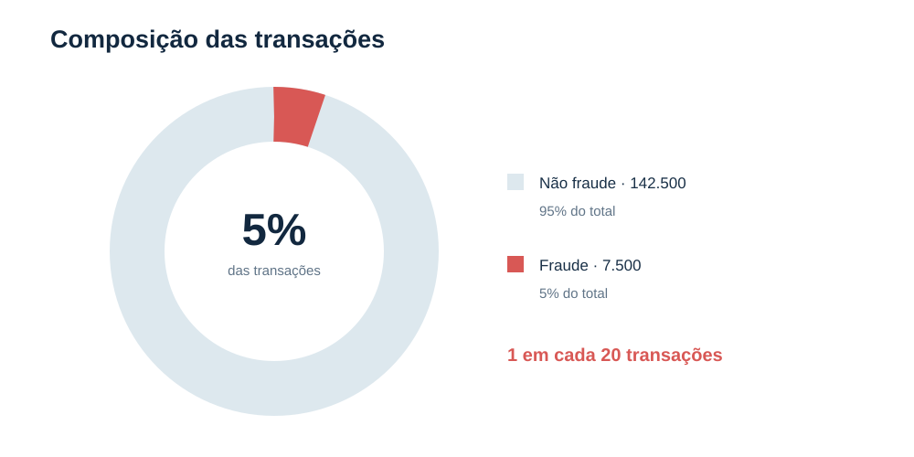
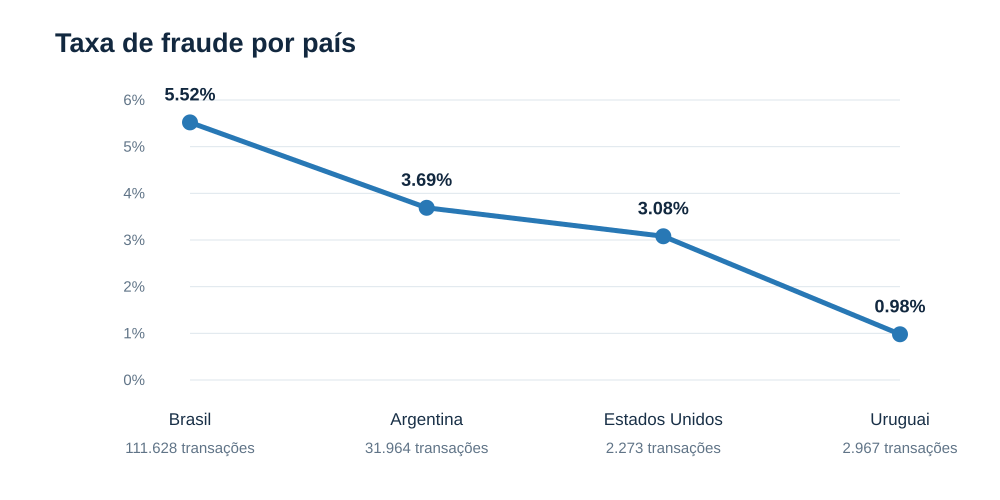
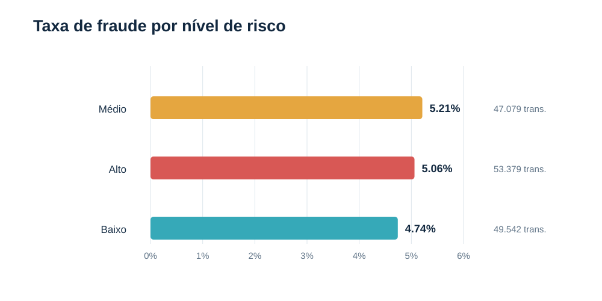
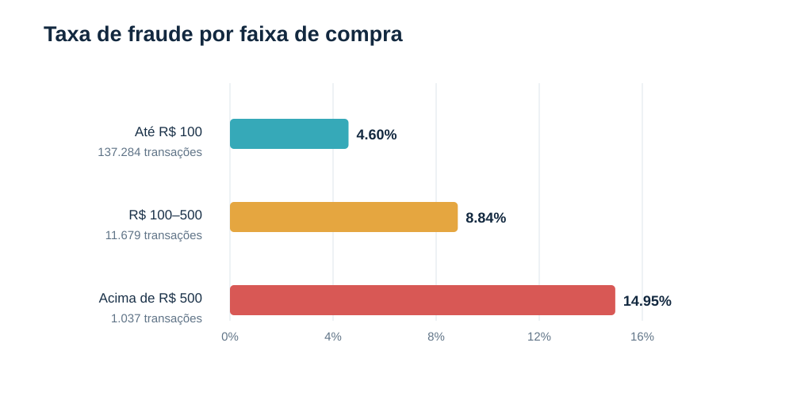
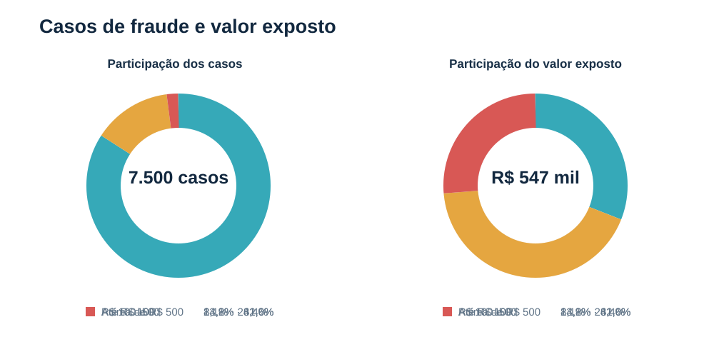
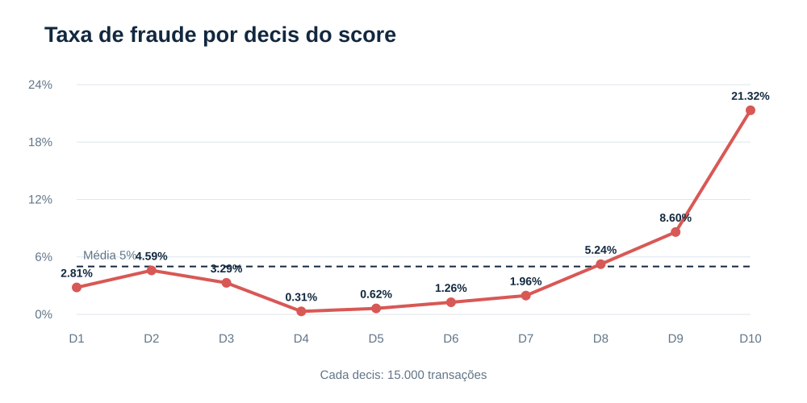

# Fraude em transações

## Onde priorizar controles para reduzir exposição

Análise executiva para decisão de negócio

**150 mil transações · 7.500 fraudes · incidência de 5,0%**

**Valor exposto:** R$ 547.271,12

---

# Objetivo e foco da conversa

## A pergunta para o negócio

> Onde um controle adicional pode reduzir mais risco com o menor atrito possível?

A análise combina incidência, volume de ocorrências e valor exposto. Os resultados indicam prioridades para teste; não comprovam causalidade nem o efeito de uma regra antes do piloto.

### Roteiro

1. **Dimensionar:** qual é a escala financeira e operacional do problema?
2. **Localizar:** em quais países, valores e grupos a incidência se concentra?
3. **Agir e medir:** que controles testar e quais indicadores proteger?

---

# Dimensão do problema

## 7.500 fraudes representam R$ 547 mil em compras

| Transações | Fraudes | Taxa | Valor exposto |
|---:|---:|---:|---:|
| 150.000 | 7.500 | 5,0% | R$ 547.271,12 |

Uma em cada 20 transações foi fraude. O ticket médio fraudulento foi **R$ 72,97**, acima do ticket geral de **R$ 43,52**. Valor exposto é montante transacionado, não perda líquida confirmada.

---

# País

## Brasil combina a maior taxa com o maior volume

O Brasil merece atenção primeiro: tem a maior taxa (**5,52%**) e concentra **111.628 transações**. A incidência é cerca de 1,5 vez a da Argentina. A consulta mostra apenas países com pelo menos mil transações; os quatro exibidos somam 148.832 registros.

*A linha conecta países ordenados pela taxa; não representa uma série temporal.*

---

# Risco da categoria

## O nível “alto” não se destaca na fraude observada

As taxas variam de **4,74% a 5,21%**, diferença de apenas **0,47 ponto percentual**. Curiosamente, “alto” não tem a maior incidência observada. Vale revisar a classificação e abrir o resultado por categoria antes de usar esse nível para bloquear compras ou exigir autenticação.

---

# Faixa de valor

## A incidência cresce conforme aumenta o valor da compra

Acima de R$ 500, a incidência chega a **14,95%**, 3,25 vezes a faixa até R$ 100, mas o grupo tem apenas 1.037 transações. Essa faixa pode comportar uma revisão reforçada com menor impacto no volume total.

*O gráfico compara faixas agregadas definidas na query; não é um histograma de transações individuais.*

---

# Concentração por valor

## Volume de casos e exposição financeira pedem controles diferentes

Até R$ 100 concentra **84,2% dos casos**: melhorias de detecção nessa faixa podem alcançar muitos eventos. Já compras acima de R$ 100 respondem por cerca de **69% do valor exposto**, embora representem apenas **15,8% das fraudes**. Vale combinar cobertura ampla nos valores baixos com revisão mais rigorosa nos valores altos.

**Faixa acima de R$ 500 — estimativas derivadas:** 155 fraudes e R$ 144.255,98 expostos, porque a linha da query foi enviada incompleta. Validar esses valores na saída integral. A perda média derivada é R$ 930,68 por fraude.

---

# Desempenho do score

## D10 tem maior fraude; score ainda exige validação

No D10, a taxa chega a **21,32%**, cerca de 4,3 vezes a média de 5%. Isso pode ajudar a priorizar análises, desde que o score esteja ordenado no sentido esperado. Os decis intermediários oscilam bastante, então é preciso validar o cálculo antes de tirar conclusões sobre o modelo.

**Antes de usar em decisões automáticas:** confirmar a direção do `NTILE`, o sentido do score, a consistência do universo e a ausência de vazamento. Calcular fraudes e métricas de ranking/calibração por decis.

---

# Plano de ação em 90 dias

## Testar controles por valor e validar o score antes de ampliar regras

### 0–30 dias · Preparar e pilotar

**Responsáveis sugeridos:** Fraude e Operações

- Validar a saída completa da faixa acima de R$ 500 e a cobertura de países.
- Pilotar revisão reforçada ou autenticação adicional em compras acima de R$ 500.
- Definir baseline e limites de atrito: aprovação, falsos positivos e fila de análise.

### 31–60 dias · Medir e ajustar

**Responsáveis sugeridos:** Produto e Fraude

- Acompanhar exposição, fraude confirmada e conversão durante o piloto.
- Testar controles seletivos em R$ 100–500, faixa que concentra 42,6% do valor exposto.
- Investigar o Brasil em separado e revisar segmentos com o time local.

### 61–90 dias · Validar e decidir

**Responsáveis sugeridos:** Dados e Risco

- Recalcular fraude por decis e confirmar ordenação e calibração do score.
- Reavaliar níveis de risco por categoria; as taxas atuais são próximas.
- Ampliar, ajustar ou encerrar o piloto conforme benefício e impacto no cliente.

**Acompanhar em todas as fases:** taxa de fraude · valor exposto · aprovação/conversão · falsos positivos · volume de revisão manual.

---

# Decisões para iniciar o piloto

## Proposta para aprovação

1. **Autorizar o piloto** de revisão reforçada ou autenticação adicional em transações acima de R$ 500, com critérios claros de liberação.
2. **Escolher uma estratégia para R$ 100–500.** O segmento tem 8,84% de fraude e responde por 42,6% do valor exposto; testar controle de menor atrito.
3. **Priorizar o acompanhamento do Brasil**, que tem a maior taxa observada e o maior volume entre os países retornados.
4. **Condicionar o uso do score à validação** de direção, ordenação, calibração e desempenho.

### Como saber se funcionou

O piloto deve reduzir fraude ou valor exposto sem deteriorar de forma inaceitável a aprovação e a experiência do cliente. Fazer revisão semanal de fraudes confirmadas e taxa, valor exposto e perda líquida, aprovação e falsos positivos, fila e tempo de revisão.

*Os resultados atuais definem prioridades para teste; o efeito dos controles será conhecido após o piloto.*
